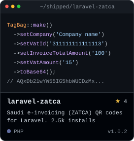
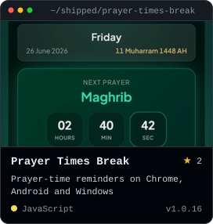
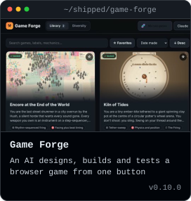

<!-- hero:start -->

<!-- hero:end -->

### `$ ls ~/shipped`

<!-- featured:start -->

<!-- featured:end -->

Also in that folder:

- **Tools:** [EchoSub Lens](https://github.com/mPhpMaster/echo-sub-lens) translates on-screen text in place · [Sayang Translate](https://github.com/mPhpMaster/sayang-translate-public) translates WhatsApp and Telegram chats on Android · [ATS CV Studio](https://github.com/mPhpMaster/ats-cv-studio) builds and checks CVs · [SteganographyPy](https://github.com/mPhpMaster/SteganographyPy) hides encrypted archives inside media files
- **Games:** [Wavebreak](https://github.com/mPhpMaster/wavebreak-godot-game), a cute 3D survivors-like with online co-op · [LetterUp](https://github.com/mPhpMaster/letterup), a Discord word game · [MTO](https://github.com/mPhpMaster/mto-game), an Arabic strategy card game · [Maqlab](https://github.com/mPhpMaster/maqlab), a party game played from phones
- **Web:** [What2Watch](https://github.com/mPhpMaster/what-to-watch) picks something to watch on Shahid or Netflix · [pixel-pets](https://github.com/mPhpMaster/pixel-pets) and [parrot.js](https://github.com/mPhpMaster/parrot.js) put pixel-art pets on your cursor

### `$ ls ~/.toolbox`

<!-- toolbox:start -->

<!-- toolbox:end -->

### `$ cat laravel.md`

<!--stat:packages-->34<!--/stat--> Composer packages published so far. A few to start with:

- **[laravel-zatca](https://github.com/mPhpMaster/laravel-zatca)**: ZATCA (Saudi e-invoicing) QR codes as Base64, TLV or an image. <!--stat:installs:mphpmaster/laravel-zatca-->2.5k<!--/stat--> installs.
- **[laravel-nova-blueprint-permission](https://github.com/mPhpMaster/laravel-nova-blueprint-permission)**: a Laravel 11 and Nova 5 starter with permissions already set up.
- **[model-query-selector](https://github.com/mPhpMaster/model-query-selector)**: a fluent builder for SQL select columns and table aliases.
- **[laravel-sanadwa-whatsapp-sdk](https://github.com/mPhpMaster/laravel-sanadwa-whatsapp-sdk)**: a PHP 8.1+ SDK for the SANAD WhatsApp API, with optional Laravel integration.
- **[rag-ai-training](https://github.com/mPhpMaster/rag-ai-training)**: a RAG knowledge base and chatbot in Laravel, with pgvector search in Arabic and English.
- The helper packages: [laravel-helpers](https://github.com/mPhpMaster/laravel-helpers), [laravel-app-helpers](https://github.com/mPhpMaster/laravel-app-helpers), [laravel-nova-helpers](https://github.com/mPhpMaster/laravel-nova-helpers), [laravel-dev-helpers](https://github.com/mPhpMaster/laravel-dev-helpers), and [the rest on Packagist](https://packagist.org/packages/mphpmaster/).

### `$ cat contact.txt`

[LinkedIn](https://www.linkedin.com/in/mohammad-al-safadi/) · [X / Twitter](https://twitter.com/mrhlack) · [hlaCk](https://github.com/hlaCk), my earlier GitHub account · [m-alsafadi](https://github.com/m-alsafadi)

I'm interested in design patterns, frameworks, packages and encryption, and I'm happy to collaborate on libraries, SDKs and tools.

🍉 I stand with Palestine 🇵🇸 #FreePalestine #SavePalestine #GazaUnderAttack

&nbsp;Each byte built with JetBrains support ❤

 &nbsp;·&nbsp; The terminal and cards on this page are redrawn every day by <a href="https://github.com/mPhpMaster/mPhpMaster/blob/main/scripts/build.mjs">a small script</a> in this repo.
