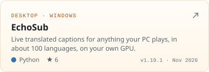
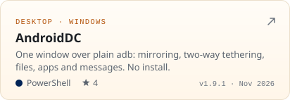
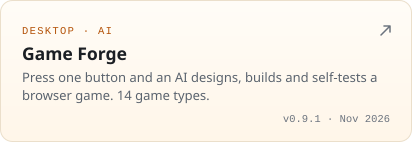
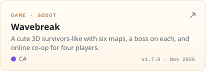
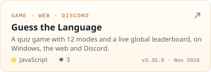
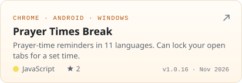
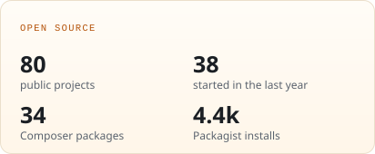
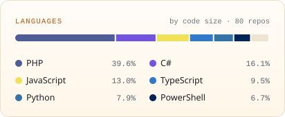

  <picture><source media="(prefers-color-scheme: dark)" srcset="https://raw.githubusercontent.com/mPhpMaster/mPhpMaster/main/assets/hero-dark.svg"></picture>

Hi, I'm Mohammad. I've worked in PHP, Laravel and Nova for years and published <!--stat:packages-->34<!--/stat--> Composer packages along the way. Lately I've been building Windows desktop tools, Android apps, browser extensions and small games, and much of it ships in both Arabic and English.

I'm interested in design patterns, frameworks, packages and encryption, and I'm happy to collaborate on libraries, SDKs and tools.

### Now building

<!-- featured:start -->

<a href="https://github.com/mPhpMaster/echo-sub"><picture><source media="(prefers-color-scheme: dark)" srcset="https://raw.githubusercontent.com/mPhpMaster/mPhpMaster/main/assets/cards/echo-sub-dark.svg"></picture></a>
<a href="https://github.com/mPhpMaster/androiddc"><picture><source media="(prefers-color-scheme: dark)" srcset="https://raw.githubusercontent.com/mPhpMaster/mPhpMaster/main/assets/cards/androiddc-dark.svg"></picture></a>
<a href="https://github.com/mPhpMaster/game-forge-releases"><picture><source media="(prefers-color-scheme: dark)" srcset="https://raw.githubusercontent.com/mPhpMaster/mPhpMaster/main/assets/cards/game-forge-releases-dark.svg"></picture></a>
<a href="https://github.com/mPhpMaster/wavebreak-godot-game"><picture><source media="(prefers-color-scheme: dark)" srcset="https://raw.githubusercontent.com/mPhpMaster/mPhpMaster/main/assets/cards/wavebreak-godot-game-dark.svg"></picture></a>
<a href="https://github.com/mPhpMaster/guess-the-language"><picture><source media="(prefers-color-scheme: dark)" srcset="https://raw.githubusercontent.com/mPhpMaster/mPhpMaster/main/assets/cards/guess-the-language-dark.svg"></picture></a>
<a href="https://github.com/mPhpMaster/prayer-times-reminder-chrome-ext"><picture><source media="(prefers-color-scheme: dark)" srcset="https://raw.githubusercontent.com/mPhpMaster/mPhpMaster/main/assets/cards/prayer-times-reminder-chrome-ext-dark.svg"></picture></a>

<!-- featured:end -->

- **Tools:** [EchoSub Lens](https://github.com/mPhpMaster/echo-sub-lens) translates on-screen text in place · [Sayang Translate](https://github.com/mPhpMaster/sayang-translate-public) translates WhatsApp and Telegram chats on Android · [ATS CV Studio](https://github.com/mPhpMaster/ats-cv-studio) builds and checks CVs · [SteganographyPy](https://github.com/mPhpMaster/SteganographyPy) hides encrypted archives inside media files
- **Games:** [LetterUp](https://github.com/mPhpMaster/letterup), a Discord word game · [MTO](https://github.com/mPhpMaster/mto-game), an Arabic strategy card game · [Maqlab](https://github.com/mPhpMaster/maqlab), a party game played from phones
- **Web:** [What2Watch](https://github.com/mPhpMaster/what-to-watch) picks something to watch on Shahid or Netflix · [pixel-pets](https://github.com/mPhpMaster/pixel-pets) and [parrot.js](https://github.com/mPhpMaster/parrot.js) put pixel-art pets on your cursor

### Laravel and Nova

- **[laravel-zatca](https://github.com/mPhpMaster/laravel-zatca)**: ZATCA (Saudi e-invoicing) QR codes as Base64, TLV or an image. <!--stat:installs:mphpmaster/laravel-zatca-->2.5k<!--/stat--> installs.
- **[laravel-nova-blueprint-permission](https://github.com/mPhpMaster/laravel-nova-blueprint-permission)**: a Laravel 11 and Nova 5 starter with permissions already set up.
- **[model-query-selector](https://github.com/mPhpMaster/model-query-selector)**: a fluent builder for SQL select columns and table aliases.
- **[laravel-sanadwa-whatsapp-sdk](https://github.com/mPhpMaster/laravel-sanadwa-whatsapp-sdk)**: a PHP 8.1+ SDK for the SANAD WhatsApp API, with optional Laravel integration.
- **[rag-ai-training](https://github.com/mPhpMaster/rag-ai-training)**: a RAG knowledge base and chatbot in Laravel, with pgvector search in Arabic and English.
- The helper packages: [laravel-helpers](https://github.com/mPhpMaster/laravel-helpers), [laravel-app-helpers](https://github.com/mPhpMaster/laravel-app-helpers), [laravel-nova-helpers](https://github.com/mPhpMaster/laravel-nova-helpers), [laravel-dev-helpers](https://github.com/mPhpMaster/laravel-dev-helpers), and [the rest on Packagist](https://packagist.org/packages/mphpmaster/).

### In numbers

<picture><source media="(prefers-color-scheme: dark)" srcset="https://raw.githubusercontent.com/mPhpMaster/mPhpMaster/main/assets/numbers-dark.svg"></picture>
<picture><source media="(prefers-color-scheme: dark)" srcset="https://raw.githubusercontent.com/mPhpMaster/mPhpMaster/main/assets/languages-dark.svg"></picture>

### Elsewhere

[LinkedIn](https://www.linkedin.com/in/mohammad-al-safadi/) · [X / Twitter](https://twitter.com/mrhlack) · [hlaCk](https://github.com/hlaCk), my earlier GitHub account · [m-alsafadi](https://github.com/m-alsafadi)

🍉 I stand with Palestine 🇵🇸 #FreePalestine #SavePalestine #GazaUnderAttack

&nbsp;Each byte built with JetBrains support ❤

 &nbsp;·&nbsp; The cards and numbers on this page are redrawn every day by <a href="https://github.com/mPhpMaster/mPhpMaster/blob/main/scripts/build.mjs">a small script</a> in this repo.
