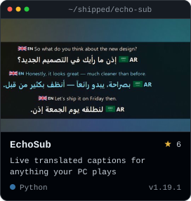
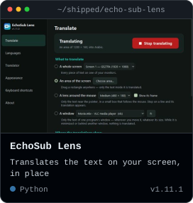
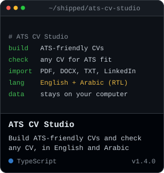
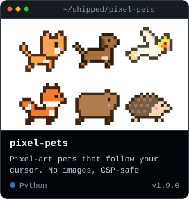
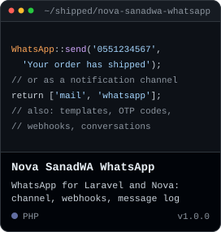
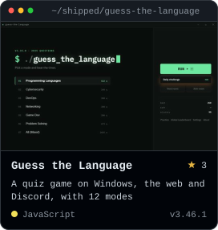
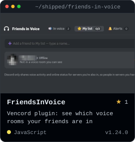
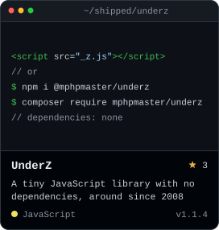
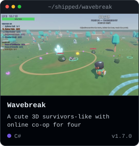
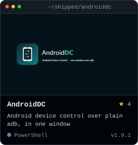

<!-- hero:start -->

<picture><source media="(max-width: 767px)" srcset="https://raw.githubusercontent.com/mPhpMaster/mPhpMaster/main/assets/terminal-mobile.svg"></picture>

<!-- hero:end -->

### `$ ls ~/shipped`

<!-- featured:start -->

<!-- featured:end -->

Also in that folder:

- **Tools:** [Sayang Translate](https://github.com/mPhpMaster/sayang-translate-public) translates WhatsApp and Telegram chats on Android · [SteganographyPy](https://github.com/mPhpMaster/SteganographyPy) hides encrypted archives inside media files
- **Games:** [LetterUp](https://github.com/mPhpMaster/letterup), a Discord word game · [MTO](https://github.com/mPhpMaster/mto-game), an Arabic strategy card game · [Maqlab](https://github.com/mPhpMaster/maqlab), a party game played from phones
- **Web:** [What2Watch](https://github.com/mPhpMaster/what-to-watch) picks something to watch on Shahid or Netflix · [parrot.js](https://github.com/mPhpMaster/parrot.js) puts a pixel-art cockatiel on your cursor

### `$ ls ~/.releases`

<!-- releases:start -->

<!-- releases:end -->

### `$ ls ~/.toolbox`

<!-- toolbox:start -->

<!-- toolbox:end -->

### `$ cat laravel.md`

Published so far: <!--stat:packages-->35<!--/stat--> Composer packages on [Packagist](https://packagist.org/packages/mphpmaster/). My Laravel and PHP repos:

<!-- laravel:start -->
**Featured**

- **[rag-ai-training](https://github.com/mPhpMaster/rag-ai-training)**: Production RAG system & AI chatbot in Laravel. Features pgvector search (SQLite fallback), OpenAI embeddings, bilingual Arabic/English support, and an admin UI with pipeline debugging.

**Models and queries**

- [laravel-model-translation-helpers](https://github.com/mPhpMaster/laravel-model-translation-helpers): Laravel model translation helpers
- [dto-generator](https://github.com/mPhpMaster/dto-generator): DataTransferObjects file generator
- [laravel-builder-filter](https://github.com/mPhpMaster/laravel-builder-filter): Easily build Eloquent queries from API requests
- [laravel-cities](https://github.com/mPhpMaster/laravel-cities): Laravel cities, countries and states
- [laravel-meta](https://github.com/mPhpMaster/laravel-meta): Fluent meta data for Eloquent models via a Metable trait for Laravel
- [laravel-traits-has](https://github.com/mPhpMaster/laravel-traits-has): Laravel Helpers: Traits Has
- [laravel-translatable](https://github.com/mPhpMaster/laravel-translatable): A Laravel package for multilingual models
- [migration-snapshot](https://github.com/mPhpMaster/migration-snapshot): hlaCk Laravel Migration Snapshot helper
- [model-query-selector](https://github.com/mPhpMaster/model-query-selector): Laravel ModelQuerySelector is a powerful package designed to simplify the construction of SQL select queries in Laravel applications

**Nova**

- [laravel-nova-add-show-all-results](https://github.com/mPhpMaster/laravel-nova-add-show-all-results): How to add "Show All" option to per page in resource - laravel nova 4
- [laravel-nova-blueprint-permission](https://github.com/mPhpMaster/laravel-nova-blueprint-permission): Laravel And Nova With Permissions Ready To Use
- [laravel-nova-clone-model](https://github.com/mPhpMaster/laravel-nova-clone-model): A Laravel Nova Package for clone a model Data
- [laravel-nova-date-field](https://github.com/mPhpMaster/laravel-nova-date-field): Laravel Nova Date Field · 212 installs
- [laravel-nova-helpers](https://github.com/mPhpMaster/laravel-nova-helpers): Laravel Nova Helpers · 101 installs
- [laravel-nova-injector](https://github.com/mPhpMaster/laravel-nova-injector): Laravel nova card to inject view or text into nova resource
- [laravel-nova-next-input-focus](https://github.com/mPhpMaster/laravel-nova-next-input-focus): Laravel Nova Next Input Auto Focus
- [nova-info-card](https://github.com/mPhpMaster/nova-info-card): Laravel Nova Resource Information Card
- [laravel-nova-sanadwa-whatsapp](https://github.com/mPhpMaster/laravel-nova-sanadwa-whatsapp): WhatsApp for Laravel & Nova via SanadWA: notification channel with template fallback, signed webhooks, message log, conversations, contacts and a diagnostics page

**Helpers**

- [laravel-helpers](https://github.com/mPhpMaster/laravel-helpers): Laravel Helpers, By hlaCk
- [laravel-app-helpers](https://github.com/mPhpMaster/laravel-app-helpers): Laravel Helpers: App · 447 installs
- [laravel-dev-helpers](https://github.com/mPhpMaster/laravel-dev-helpers): Laravel helpers for quick development
- [laravel-helpers2](https://github.com/mPhpMaster/laravel-helpers2): Laravel Helpers2 · 467 installs
- [laravel-class-access-wrapper](https://github.com/mPhpMaster/laravel-class-access-wrapper): Laravel class access wrapper
- [laravel-class-to-function](https://github.com/mPhpMaster/laravel-class-to-function): Laravel Helpers: Class To Function
- [laravel-guesser-helpers](https://github.com/mPhpMaster/laravel-guesser-helpers): Laravel Guesser Helpers · 209 installs
- [laravel-helper-loader](https://github.com/mPhpMaster/laravel-helper-loader): Laravel helpers files loader
- [laravel-start](https://github.com/mPhpMaster/laravel-start): Laravel Helpers: Laravel Start
- [php-tools](https://github.com/mPhpMaster/php-tools): Laravel helper library with global functions, traits and artisan setup commands

**More packages**

- [laravel-zatca](https://github.com/mPhpMaster/laravel-zatca): Laravel helper to generate the QRcode for ZATCA E-Invoicing system · 2.5k installs
- [laravel-blade-widgets-directive](https://github.com/mPhpMaster/laravel-blade-widgets-directive): laravel blade widgets directive
- [laravel-form-submit-shortcut](https://github.com/mPhpMaster/laravel-form-submit-shortcut): Laravel form submit shortcut package
- [laravel-scroll-to-top](https://github.com/mPhpMaster/laravel-scroll-to-top): Laravel Scroll page to top package · 207 installs
- [tdes](https://github.com/mPhpMaster/tdes): Php TDES Cipher using openssl
- [laravel-sanadwa-whatsapp-sdk](https://github.com/mPhpMaster/laravel-sanadwa-whatsapp-sdk): PHP 8.1+ SDK with optional Laravel integration for the SANAD WhatsApp Public API
- [style-attribute](https://github.com/mPhpMaster/style-attribute): Laravel HTML style attribute builder
<!-- laravel:end -->

### `$ cat contact.txt`

[LinkedIn](https://www.linkedin.com/in/mohammad-al-safadi/) · [X / Twitter](https://twitter.com/mrhlack) · [hlaCk](https://github.com/hlaCk), my earlier GitHub account · [m-alsafadi](https://github.com/m-alsafadi)

I'm interested in design patterns, frameworks, packages and encryption, and I'm happy to collaborate on libraries, SDKs and tools.

🍉 I stand with Palestine 🇵🇸 #FreePalestine #SavePalestine #GazaUnderAttack

&nbsp;Each byte built with JetBrains support ❤

 &nbsp;·&nbsp; The terminal and cards on this page are redrawn every day by <a href="https://github.com/mPhpMaster/mPhpMaster/blob/main/scripts/build.mjs">a small script</a> in this repo.
